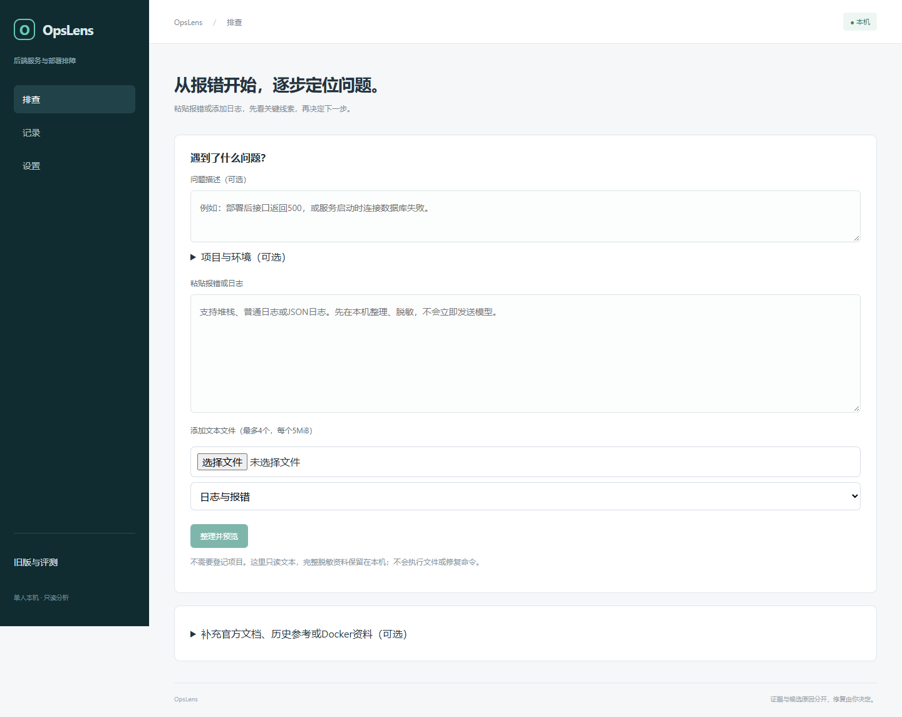

# OpsLens

面向后端开发者的本机排障助手：**提交报错与日志 → 找到关键线索 → 获得下一步检查 → 补充结果继续排查**。

需求整理与检查清单工作台已独立为[CaseFlow](https://github.com/chen-xinyi111/caseflow)。


聚焦启动失败、接口异常、依赖连接失败、端口冲突和配置问题，支持不同语言的文本日志。无需登记项目或建立知识库，Docker采集是可选资料来源。单人本机部署，修复由用户执行。

## 开始使用

本机打开[排查助手](http://127.0.0.1:18190/)。首次安装需要 Windows、PowerShell 7、Docker Desktop Linux 容器、Python 3.12–3.14、Node.js 24、pnpm 11：

```powershell
./scripts/local/Setup.ps1
./scripts/local/Start.ps1
```

默认仅启动平台和数据库，绑定127.0.0.1。依赖使用锁文件；首次依赖和镜像下载需要网络。本机日志整理无需模型密钥、语义索引或同目录项目。

1. 描述问题或直接粘贴报错，也可添加 `.log`、`.txt`、`.json`、`.jsonl` 文件。
2. 点击“整理并预览”，查看关键线索、脱敏原文及将发送的范围。
3. 在“设置”明确启用有效模型配置；确认选中资料后开始分析。
4. 按最多三项建议检查，补充实际结果继续同一条排查，或记录用户反馈、导出Markdown。

支持UTF-8/UTF-8 BOM，每次最多4个文件、每个5MiB；完整输入在本机扫描和脱敏，重复报错合并展示，保留原记录位置。模型每次输入最多32KiB，省略范围可见、可调整。默认一次分析，结构或引文无效最多更正一次；响应或用量未知时不自动重试。

## 模型与联网

新模型流程默认关闭。可选择原百炼免费模式，继续受原逐模型额度核验保护；也可明确启用兼容的 `/v1/chat/completions` 接口。密钥通过服务端环境变量配置，浏览器仅填写变量名称。默认每日最多20次请求，每次最多2048输出Token；数据库先预留请求次数，更正也计入预算。这是请求/输出限制，不是精确金额上限，不自动切换模型或付费降级。

联网只读取用户提供或选择的官方文档链接，不搜索；使用可编辑域名白名单、地址/重定向校验、正文大小与超时限制。问题和日志不作为抓取请求参数。获取失败仍可继续整理日志。

## 旧功能与证据

主导航为“排查、记录、设置”。“旧版与评测”保留0.4项目调查、知识库、演示、评测、测试任务和实验恢复。已有浏览器记录可继续打开，没有删除旧数据。青禾/其他外部项目仍仅只读建议，恢复接口从后端拒绝。

正式528条旧结果（480条检索＋48条调查）、650条原始评测模型请求及48条事实复核继续保留；它们不能用于证明0.5新流程效果。先前工程验收采用可控响应；后续累计完成9轮真实Qwen报告、21处事实原文引文匹配；保留1次TLS连接未知失败，以及1轮经一次更正仍未通过的引用编号失败。新版试用新增2轮完成报告；免费预算保护阻止后续两轮发送，尚未完成三类各两轮目标。仍发现干扰心跳被误用、过强根因措辞等问题；没有人工耗时对照，不宣称准确率或效率提升。见[验证范围与限制](docs/VALIDATION.md)。

```powershell
./scripts/local/Check.ps1
./scripts/local/Stop.ps1                    # 保留数据库卷
./scripts/local/Backup.ps1 -VerifyRestore  # 私有一致性备份与独立还原验证
```

本机支持私有一致性备份与独立还原，38张表数量与内容摘要校验通过。数据库、原始模型请求及账户配置不上传。

[使用说明](docs/PRODUCT.md) · [部署与排错](docs/DEPLOYMENT.md) · [归档与还原](docs/ARCHIVE.md) · [架构](docs/ARCHITECTURE.md) · [验证记录](docs/VALIDATION.md)

## 开发验证

```powershell
./.venv/Scripts/python.exe -m pytest --ignore=tests/test_integration.py --basetemp=.runtime/pytest-local
./.venv/Scripts/python.exe scripts/export_openapi.py
cd frontend
pnpm run types
pnpm test
pnpm run build
```

数据库测试使用隔离schema与可控模型，不消耗真实模型额度。4项旧live检查依赖正常实验实例在线，不为检查启动它。不提供自动修复、远程执行、自动监控或公网账号。
