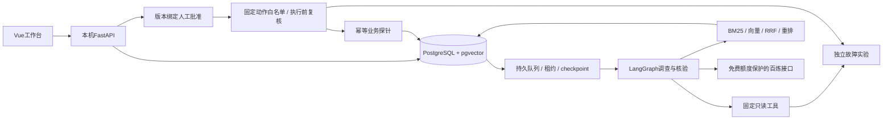

# 架构与已实现边界

平台数据库、正常实验和故障实验分别使用独立Compose项目、网络、数据库与卷。页面不提供任意Shell/SQL/故障注入接口；项目一不进入项目二仓库。外部材料可以只读导入，但自动恢复仅固定故障实验实例。

调查模式包括单Agent、动态多Agent、独立核验与有界重新规划。最多6子任务、2并行、8生成、12工具、2重新规划和240秒活动处理时间。运行事实和手册来源分开保存；核验通过后人工批准绑定方案版本/摘要/有效期，执行前再读取状态，实际新任务验证业务。

租约5秒续约、30秒失效；任务最多自动接管2次，执行批次防止旧线程迟到写入。步骤/引用/checkpoint/事件事务保存，收费模型未知响应保留额度且不自动重试；已有动作不重发，固定编号查回探针，不能确定效果则转人工。历史无checkpoint调查不猜测恢复位置。SSE游标与请求编号支持重连/幂等。

资料切分保留来源、版本、段落位置、原文及索引版本；每路最多20条召回，RRF融合，重排最多20，最终最多6条引用。模型密钥通过本机环境读取；账户免费核验按模型、端点/密钥指纹绑定，24小时失效，缺失即阻断，无付费降级。

评测冻结120检索问题/60调查库；实测用户授权24调查双方式，480+48=528条。原问题/输出/规则分数保留，事实复核另存。两个未连接输入原分组跨集合重复，分析单列12共享控制试次，不声称12独立拒答案例或24独立故障。

当前局限：本机单用户、短手册小语料、既有实验机制、源级相关性标注；没有公网、多租户、集群调度、生产备份恢复、真实外部故障评测或统计显著性证据。引用存在性不代表语义支持，安全停止不代表正确诊断。3.3可控演示验证工程闭环，不能替代3.2真实模型效果。

## 0.4.0 外部项目只读调查

登记Compose项目/服务范围 → 本机限定采集 → 不可覆盖快照与项目资料版本 → 用户预览选择 → 摘要绑定发送确认 → 现有调查/核验 → 引用原文与人工建议。外部目标使用独立四张表，不改实验集合和原始评测。状态GET不保存快照，采集POST幂等；snapshot/consent/external IDs增量加入调查输入。

Docker只允许项目过滤ps、选定标签/状态/镜像字段的inspect和80行/64KiB日志。没有exec、环境变量、挂载、业务数据库或外部恢复工具。知识用用户选中项目资料本机BM25，原文固定在快照。各次模型生成重新检查确认；外部补查要求新快照确认。核验保留候选一致性、引用和证据类别约束，实验v1业务版本条件不用于外部项目。

默认启停只作用于平台。Backup.ps1先检查任务，再暂停平台进程、保留数据库/其他服务，pg_dump一致性导出，独立数据库还原并校验表摘要；密钥和账户配置另行管理。健康接口delivery=3.3保留兼容，version=0.4.0支持启动升级判断。

## 0.5 日志排查链路

主流程在 `opslens.diagnostic`：intake逐行扫描与脱敏，store保存版本化附件和摘要绑定预览，model保存配置与原子请求预留，worker通过已有Runtime执行一次分析、最多一次更正，API提供会话/附件/预览/确认/事件/反馈/导出。前端以编号和输入摘要找回不确定提交，浏览器不持久化上传正文或密钥。

八张新表与旧实验表分离，队列沿用durability family与租约，先保存issued再调用模型。进程中断后未知调用不重发，结果已落库则通过查询/事件游标恢复。新链路没有恢复API、业务执行工具或多Agent图；旧图与恢复逻辑保留在维护区。

本机关键词检索选项目资料，历史仅经用户选择加入。官方文档通过固定经过校验的公网IP抓取，并保持原Host/TLS认证，拒绝私网及白名单外重定向；数据来源/时间写入附件provenance。手动日志时间只表示录入时间，不能证明实时状态。
